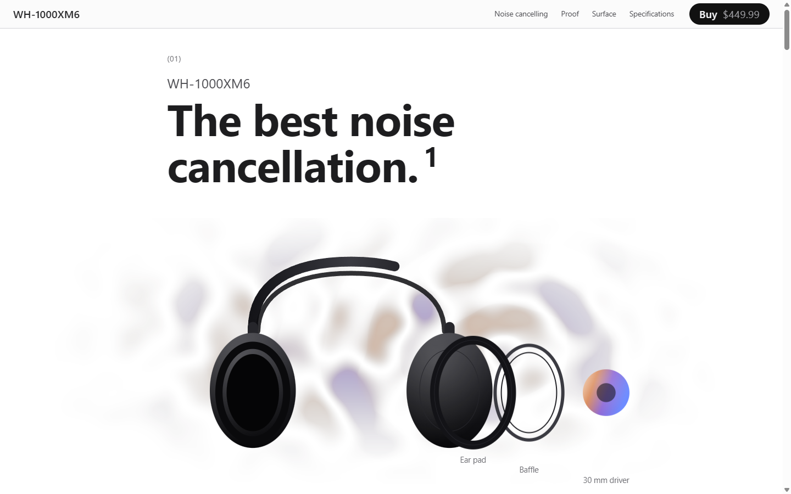
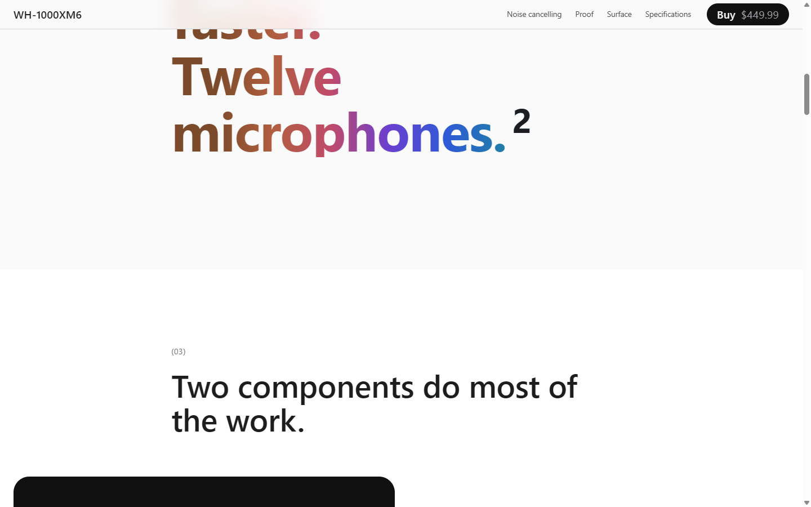
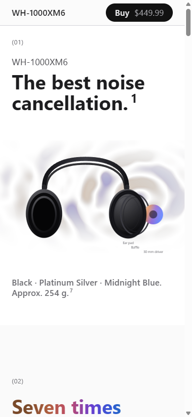

# WH-1000XM6 product page

A single-page product site for the Sony WH-1000XM6, built in the **PRECISION** register from the
`freedom` skill and finished under `impeccable`. Plain static files — no bundler, no dependencies,
no animation library.

## Run it

```
cd "F:\Brain\02-PROJECTS\sony-wh-1000xm6"
py -m http.server 8080
```

Then open <http://localhost:8080>. (`py`, not `python` — bare `python` hits the Microsoft Store stub
on this machine.)

The only external request is the Inter variable font from Google Fonts. Offline, the page falls back
to `system-ui` and everything else still works.

## Files

| Path | What it holds |
| --- | --- |
| `DESIGN.md` | The register, the two hard-rule decisions, the motion budget, the waivers, and every content claim with its source. **Read this before changing anything visual.** |
| `index.html` | The whole page. Both SVG scenes are inlined so they are scriptable. |
| `css/tokens.css` | Palette, the optical-size pair, the thirteen-step type scale, the two grids. |
| `css/page.css` | Sections, hand-set rhythm, components, reduced-motion block. |
| `js/scrub.js` | The anchor-expression keyframe DSL, implemented directly. ~200 lines, no GSAP. |
| `js/field.js` | The hero ground: a WebGL counter-wave shader. Raw WebGL, one fragment shader, no library. |
| `js/scenes.js` | The three scenes and the proof module's tab list. |
| `.impeccable/config.json` | Detector waivers. One rule, and it is a register device. |

## Editing the motion

Scene timing is authored in the markup, never in JavaScript:

```html
<div data-scene="hero" data-keyframe='{"start": "t - 60vh", "end": "b - 20vh"}'>
```

`t` is the anchor's top in document coordinates, `b` its bottom, `h` its height; `a0t` / `a1h` index
into an optional `anchors` array; `vh` and `px` combine with `+` and `-`. Retiming a scene is a
one-attribute edit — no CSS, no JS, no rebuild.

`{"disabledWhen": "no-enhance"}` switches a scene off entirely.

## Reduced motion

Decided per effect at build time, in JavaScript, because a CSS media query never sees scroll-driven
motion. Under `prefers-reduced-motion: reduce` each scene is called **once** at its narrative peak
and no listeners are attached — the hero holds at 0.42 (partially separated, so the driver is still
visible), the stage unpins along with its runway, and the proof bars go straight to their final
widths. Nothing is slowed down or played at a reduced amplitude.

The hero ground never initialises at all under `reduce`, and never initialises without a WebGL
context either. In both cases the CSS wash in `.field-wrap` is the finished hero ground, not a
placeholder for a missing one. With JavaScript off the canvas is never inserted. All three paths
were verified in real Chrome, not emulated.

## Status

This is an **independent design exercise**. It is not affiliated with, endorsed by, or produced for
Sony Group Corporation. Product names and specifications belong to Sony and are reproduced with
sources in the page's own footnotes. The product illustrations are hand-drawn vector diagrams, not
Sony imagery.

For that reason the page is not published to a shared URL.

## Screenshots






